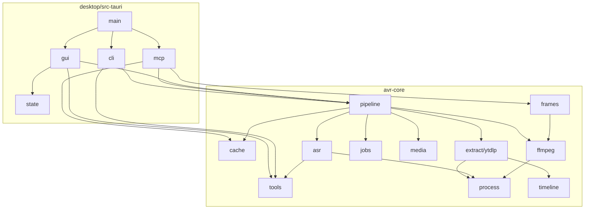
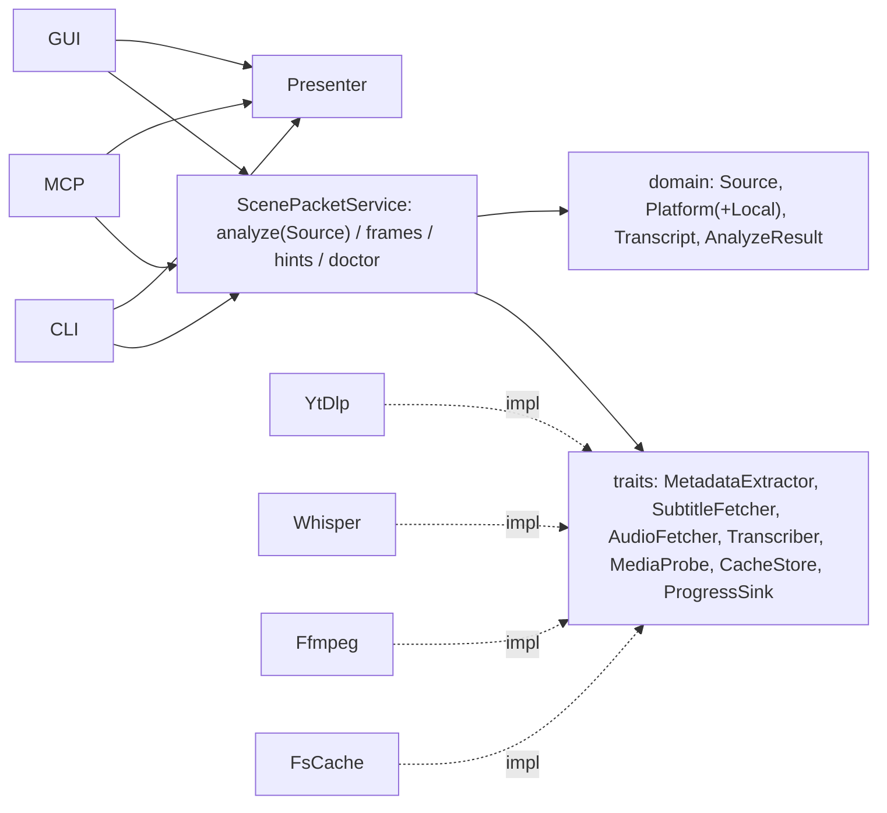

# ScenePacket 优化规划（规划角色产出）

> 作者：规划｜验收：审查｜实施：执行｜基线提交：`1e34274`｜日期：2026-10-10
> 本文只做规划，不改动源码。团队统一在 `optimize` 分支上工作。

## 0. 参考依据（简）
- Rust API Guidelines（C-GOOD-ERR、C-COMMON-TRAITS）：https://rust-lang.github.io/api-guidelines/
- 六边形架构 / Clean Architecture（依赖只指向内层）：Alistair Cockburn；Robert C. Martin, *Clean Architecture*
- 高内聚低耦合、单一职责、DRY：*Code Complete*；*A Philosophy of Software Design*（深模块、信息隐藏）
- 错误处理：库用 thiserror、应用用 anyhow，https://docs.rs/thiserror
- 可测试性：依赖注入 + trait 抽象外部进程（*Working Effectively with Legacy Code* 的“接缝”）
- Tauri 2：命令层保持薄，业务放独立 crate，https://v2.tauri.app/develop/calling-rust/

## 1. 现状架构

规模：avr-core ≈3.2k 行，桌面壳 ≈0.7k 行，UI `App.svelte` 351 行单文件，`tools/` 7 个 Python/PS 脚本。

## 2. 基线（2026-10-10 实测）
| 项目 | 结果 |
|---|---|
| 系统 rustc 1.85.1 | 失败：依赖 icu_* / time 0.3.55 需 rustc ≥1.88；仓库未声明 `rust-version`、无 `rust-toolchain.toml` |
| 新 stable `cargo test -p avr-core` | 通过 15/15（8 单元 + 7 集成） |
| `cargo clippy -p avr-core --all-targets` | 13 条警告：未用导入×5、可 derive 的 impl×2、`JobManager` 缺 Default、`pid` 未用、`kill_process_tree` 未用、`YtDlpJson` 死代码、无效运算、可合并 if |
| `cargo check --workspace` | Linux 缺 GTK/pkg-config（glib-sys），Tauri 壳未验证 |

## 3. 耦合热点（附证据）
1. 全局单例 JobManager：`jobs.rs:147` `shared_job_manager()` 被 `pipeline.rs:69,91,188` 直接调用，无法注入；GUI 未订阅进度，另发 `job-progress`（`gui.rs:206`）。
2. pipeline 依赖具体实现：`pipeline.rs:115` `YtDlpExtractor`、`:131` `AsrService::new`、`:177` `FfmpegContext::resolve`，无 trait 端口，测试需真实外部工具。
3. 表示层在核心：`pipeline.rs:304-355` 的 `compact_mcp_payload/full_mcp_payload` 是 MCP DTO，却被 CLI（`cli.rs:32,62`）和 GUI（`gui.rs:215,238`）复用。
4. 文件锁不可靠：`jobs.rs:104-121` “存在即锁”，崩溃后永久阻塞；`jobs.rs:78` waiter 遇 leader 丢失 `unwrap_or(Ok(()))` 把失败当成功；非 RAII 释放。
5. 平台判定散落且错标：`ytdlp.rs:249,260,303`、`cache.rs:64-65`、`pipeline.rs:235`（本地文件被标为 `Platform::Bilibili`）。
6. 工具 ID 魔法字符串：`cli.rs:90`、`gui.rs:135`、`gui.rs:157-163`、`registry.rs:65`；whisper 清单谓词 `gui.rs:141,175` 重复且 `a && b || c` 无括号。
7. 配置双路径：`cfg.tools.whisper_model_path` 与 `cfg.asr.model_path`（`asr/engine.rs:60-68`），`pipeline.rs:145,242` 记录的模型可能与实际不一致。

## 4. GUI / CLI / MCP 重复逻辑
| 重复点 | 位置 |
|---|---|
| exe 目录 → `resolve_data_root` → `PipelineContext::load` | `cli.rs:15-18,45-48,75-76`，`mcp.rs:206-209`，`gui.rs:32-36,88-90` |
| 每次新建 tokio runtime + `.unwrap()` | `cli.rs:19-23,49-53`，`mcp.rs:212-216` |
| URL / 本地路径分派 | `mcp.rs:159-163` |
| 结果 → JSON（硬编码 3000） | `cli.rs:24,54`，`gui.rs:215,238`，`mcp.rs:166-171` |
| 错误呈现三套 | `cli.rs` format_user，`mcp.rs:176-184` 手写 JSON，`gui.rs` 字符串 |
| 两套 singleflight + finalize 样板 | `pipeline.rs:60-83` vs `173-202`；`149-170` vs `239-251` |
| `io_err` 帮助函数 ×4 | `jobs.rs`、`cache.rs`、`export.rs`、`tools/install.rs` |

## 5. 分模块问题
- error.rs：无 `source()` 链；`Display` 混入 UI 文案；建议 `#[non_exhaustive]`、`#[source]`、`From<io::Error>` 等。
- process.rs：`run_blocking` `unwrap()`（:162）；Job Object 空实现，超时未杀进程树。
- timeline.rs：`strip_tags` 每次编译 Regex（:157）。
- frames.rs：`partial_cmp().unwrap()`（:90,:102）遇 NaN panic → `total_cmp`。
- extract/ytdlp.rs（347 行最大）：参数/元数据/字幕/音频/片段/错误分类混杂；`file_name().unwrap()`（:115）；死代码 `YtDlpJson`。
- cache.rs：无 schema 版本；`find_cache_by_url` 线性扫描；缺 video.json 时伪造 VideoInfo。
- config.rs：无校验层。
- gui.rs：`catch_unwind` 包主循环意义有限；后台任务无取消、无进度转发。
- mcp.rs：错误以 success 返回（应 `is_error`）；`analyze_video` 描述写反；`unwrap_or_default` 吞序列化错误。
- UI：`App.svelte` 单文件，无类型化 invoke 封装。
- 工程化：无 CI、无 `rust-version`、无 fmt/clippy 门禁；`lib.rs:21` `VERSION` 与 Cargo 版本重复。

## 6. 目标架构（端口与适配器）

原则：入口只做解析与呈现；Service 构造注入端口与 JobManager；domain 无 IO；payload 移入 presenter。

## 7. 重构待办（负责人：执行 实施，审查 验收；每项独立提交，保持测试绿）

### P0 正确性与工程底线
- **P0-1 工具链与 CI**｜文件：`Cargo.toml`、`rust-toolchain.toml`、`.github/workflows/ci.yml`｜做法：`rust-version="1.88"`；CI 跑 fmt/clippy -D warnings/test（avr-core），Windows 跑 `check --workspace`｜风险：低｜验收：CI 三项绿。
- **P0-2 清零 clippy 与 panic 点**｜文件：`frames.rs:90,102`、`process.rs:162`、`ytdlp.rs:115`、`timeline.rs:157`、`cli.rs` runtime unwrap｜做法：total_cmp、LazyLock、`?`/expect、删死代码｜风险：低｜验收：`clippy -D warnings` 通过。
- **P0-3 作业锁与 singleflight**｜文件：`jobs.rs`｜做法：`create_new` 原子建锁写 PID+时间，陈旧锁回收，RAII guard，waiter 得到真实错误｜风险：中｜验收：并发只执行一次、陈旧锁可恢复、失败传播的测试。
- **P0-4 Platform::Local**｜文件：`models.rs`、`pipeline.rs:235`、`cache.rs:64`、`ytdlp.rs:303`｜做法：新增 Local，`FromStr`/`as_str` 对称｜风险：低（兼容旧缓存）｜验收：本地转写 platform=="local"，往返测试。

### P1 解耦与去重
- **P1-1 统一 Bootstrap**｜`cli.rs`、`mcp.rs`、`gui.rs`、新 `bootstrap.rs`｜一个 `load_context()` + 单 runtime｜验收：`resolve_data_root(exe_dir)` 只出现一处。
- **P1-2 Source + 统一 analyze**｜`pipeline.rs`、`mcp.rs:159`｜`enum Source`、合并 singleflight 与 `finalize()`｜验收：pipeline 行数 -25%，行为测试不变。
- **P1-3 Presenter 外移**｜`pipeline.rs:304-355` → `presenter.rs`｜`#[derive(Serialize)]` DTO 替代 `json!`，默认长度常量化｜验收：payload 快照测试字段一致。
- **P1-4 端口 trait + DI**｜`pipeline.rs`、`extract/`、`asr/`、`ffmpeg.rs`、`jobs.rs`｜定义端口 trait，Service 注入 `Arc<dyn …>` 与 JobManager，去除全局｜风险：中高，分 2-3 次提交，排在 P1-2 后｜验收：fake 测试覆盖字幕命中/走 ASR/ASR 未配置/缓存命中。
- **P1-5 错误模型**｜`error.rs` 及 4 处 io_err｜source 链、From、Display 只含 message；MCP 用 `is_error`｜验收：io_err 合一，MCP 错误 `isError:true`。
- **P1-6 ToolId 枚举**｜`tools/registry.rs`、`manifest.rs`、`gui.rs:135-180`、`cli.rs:90`｜`enum ToolId` + `ALL` + `manifest_for`、`ToolsConfig::set_path`｜验收：无工具名字符串数组，whisper 谓词单测。
- **P1-7 GUI 进度贯通**｜`gui.rs`、`jobs.rs`、`App.svelte`｜订阅 JobManager 转发，支持取消｜验收：UI 显示各阶段。

### P2 结构与体验
- P2-1 拆分 `extract/ytdlp.rs`（args/metadata/subtitles/audio/classify，错误分类纯函数单测）
- P2-2 配置收敛（合并两处模型路径 + 迁移 + `AppConfig::validate()`）
- P2-3 缓存 `schema_version` 与 URL 索引
- P2-4 Windows Job Object / 超时杀进程树接线（`process.rs:141-155`）
- P2-5 `App.svelte` 组件化 + `api.ts` 类型化
- P2-6 `VERSION` 改 `env!("CARGO_PKG_VERSION")`；`tools/` 脚本说明
- P2-7（可选）收窄 `pub` API 或拆 domain/infra crate

## 8. 顺序
P0-1 → P0-2 → P0-4 → P0-3 → P1-1 → P1-2 → P1-3 → P1-5 → P1-6 → P1-4 → P1-7 → P2-*。每步：执行 提交 → 审查 对照验收 + 测试 → 继续。
